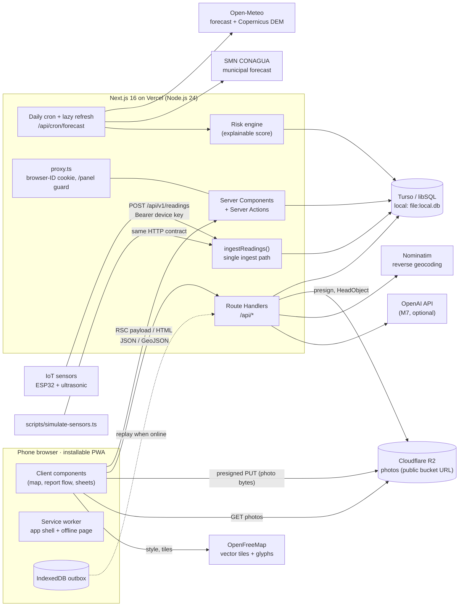
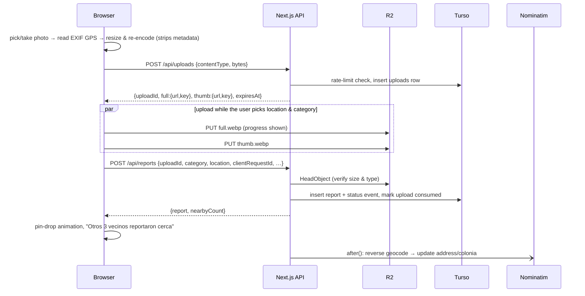

# Cauce: Project Plan

> Community flood-reporting map for Matamoros, Tamaulipas.
> Built for the Hackathon of the Agencia Espacial Mexicana (AEM).
>
> **Status:** approved 2026-10-22, implementation in progress · **Date:** 2026-10-22
> **Language rule:** code, identifiers, comments, docs, commits and AI prompts are in English. Everything a user reads in the app is in Spanish.

---

## 0. Decisions so far

| #     | Topic         | Decision                                                                                                                                                                                    |
| ----- | ------------- | ------------------------------------------------------------------------------------------------------------------------------------------------------------------------------------------- |
| 1     | Pilot         | Matamoros, Tamaulipas. Focus colonias: **Buenavista, San Francisco, Los Sauces** (plus nearby Paseo Residencial, Nuevo Milenio and the Las Brisas group, which flooded in the same events). |
| 2     | UI language   | Spanish first (`es-MX`), English as a second locale. next-intl with a cookie-based locale and no `/es/` URL prefix.                                                                         |
| 3     | Categories    | 6 chips: blocked drain, broken/missing cover, flooded street, overflowing drain canal ("dren"), sewage backflow, other.                                                                     |
| 4     | Severity      | One optional tap: water depth for water categories, "partial/full" for drains, "damaged/missing" for covers. Also normalized to 1–3.                                                        |
| 5     | Lifecycle     | Resolved with ≥ 2 "Fixed" from different browsers **and** more "Fixed" than "Still there" since the last status change. Water categories expire after 24 h without a fresh "Still there".   |
| 6     | Accounts      | Anonymous only (signed browser-ID cookie). 3 flags hide a report pending review. Moderation lives in the panel.                                                                             |
| 7     | Home          | `/` opens straight on the map. `/acerca` holds the pitch and the AEM hackathon credit.                                                                                                      |
| 8     | Offline       | IndexedDB outbox for reports, auto-sent when back online. No Background Sync API (iOS lacks it).                                                                                            |
| 9     | Hackathon     | No fixed deadline yet. Milestones are ordered so every one ends in a demo-able build.                                                                                                       |
| 10–12 | Demo          | Live phone demo on a deployed HTTPS URL over mobile data, plus a backup video. Simulator only (no hardware).                                                                                |
| 13    | Seed photos   | You shoot 15–20 real photos (preferred). Until then, category illustrations stand in, so nothing is blocked.                                                                                |
| 14    | Map           | MapLibre GL JS 6 + OpenFreeMap vector tiles, behind our own `features/map` wrapper. Protomaps PMTiles on R2 is the fallback.                                                                |
| 15    | Addresses     | Server-side reverse geocoding with Nominatim, once per report: stores the street and the **colonia**.                                                                                       |
| 16    | Open data     | No official Matamoros drain/flood dataset found yet. We seed a `flood_history` table from dated news reports (with sources) and keep an import path open for official data.                 |
| 17    | Accounts/keys | You have R2, Turso and Vercel. **No env vars are needed until the deploy milestone (M5).** You type them into `.env.local` and Vercel yourself; I never need to see them.                   |
| 18    | Hosting       | Vercel on the Node.js 24 runtime. Bun is the package manager and script runner everywhere.                                                                                                  |
| 19–20 | Insights      | `/panel` behind a shared password. Thin slice approved as M6: forecasts, explainable risk score, ranked "clear these drains" list, hex risk layer.                                          |
| 21–25 | Sensors       | ESP32 + ultrasonic, Wi-Fi first. `level_cm` plus optional raw `distance_cm`. Per-device thresholds. One `ingestReadings()` function serves every transport.                                 |
| 26    | AI            | **OpenAI** (no Anthropic key). Default model `gpt-6-luna`, set in env. Stretch milestone M7.                                                                                                |
| 27–28 | Brand         | Name **Cauce**. "Civic signal" identity: storm navy + signal amber. Bricolage Grotesque + Atkinson Hyperlegible Next.                                                                       |
| 29    | Tooling       | Biome, `bun test` for core logic, DB-backed rate limits, 5-minute presigned URLs.                                                                                                           |

**New proposal for your approval (space-agency angle):** add a satellite-derived terrain factor to the risk score in M6, using **Copernicus DEM GLO-90** elevation from ESA via the Open-Meteo Elevation API (free, no key). It costs about half a day, and it gives the AEM judges a concrete "datos espaciales" story. More satellite sources are in the roadmap (§10).

---

## 1. Context: why Matamoros, why now

- On **2–4 Oct 2026**, _frente frío No. 1_ left **215.9 mm** of rain in Matamoros (Junta de Aguas y Drenaje, JAD). Buenavista, San Francisco, Los Sauces and Paseo Residencial were cut off by standing water. On Avenida del Niño a drain overflowed with sewage, and on Avenida Solidaridad cars were stranded in water over 1 m deep. ([Plano Informativo, 4 Oct 2026](https://planoinformativo.com/1173492/dejan-lluvias-a-matamoros-bajo-el-agua))
- Buenavista and San Francisco sit in **low-lying zones with limited drainage**, which makes them flood repeatedly ([Posta](https://www.posta.com.mx/mexico/claudia-sheinbaum-por-primera-vez-visita-una-zona-de-desastre/vl2024226)).
- **Trash in the drains** is a recurring cause cited by the authorities. In May 2022 the Dren 20 de Noviembre overflowed mainly because of garbage thrown into streets and canals ([Posta](https://posta.com.mx/tamaulipas/se-desborda-dren-en-matamoros-e-inunda-colonias-aledanas/586586)).
- Earlier events: a heavy storm with 155 colonias flooded (Sept 2024, [N+](https://www.nmas.com.mx/tamaulipas/inundaciones-en-matamoros-155-colonias-afectadas-tras-lluvias-junta-de-aguas-y-drenaje/)), Hurricane Francine (Sept 2024, [Excélsior](https://www.excelsior.com.mx/nacional/francine-provoca-caos-e-inundaciones-en-matamoros-tamaulipas/1673374)), and a storm in March 2025 ([El Imparcial](https://www.elimparcial.com/mexico/2025/03/28/tromba-inunda-cientos-de-colonias-en-reynosa-y-matamoros/)).
- **Who acts on the data:** JAD Matamoros (drainage), Protección Civil Matamoros, CONAGUA/SMN (forecasts).
- **Time zone:** `America/Matamoros`. It follows US daylight saving (UTC−5 now, UTC−6 from early November), unlike most of Mexico.

### Pilot geography (approximate; please confirm)

OpenStreetMap coverage of colonia boundaries in Matamoros is thin. These centroids come from OSM, postal-code data and nearby landmarks:

| Place                                                                                   | Lat, Lng                          | Confidence |
| --------------------------------------------------------------------------------------- | --------------------------------- | ---------- |
| City center (Plaza Hidalgo)                                                             | 25.8797, −97.5047                 | high       |
| **Buenavista** (OSM residential area, CP 87347)                                         | 25.8226, −97.5620                 | medium     |
| **San Francisco** (near "San Francisco del Rincón", next to Buenavista)                 | 25.8312, −97.5617                 | low        |
| **Los Sauces** (CP 87380, shared with Valle Alto / Paseo Residencial / Rincón Colonial) | ~25.851, −97.520                  | low        |
| Los Palmares / Rinconada de las Brisas (flooded in the same event)                      | 25.844, −97.553 / 25.847, −97.564 | medium     |
- **Default map view:** center 25.840, −97.540, zoom 13.5. This frames the west and southwest flood belt plus downtown.
- **Demo neighborhood view:** Buenavista at zoom 15.
- All of this lives in `src/config/pilot.ts`. Correcting it means editing that file and re-seeding.

---

## 2. Tech stack and pinned versions

Versions come from `bun pm view <pkg> version` on 2026-10-22. Docs were read for every item marked 📖.

| Area          | Package                                               | Version         | Notes                                                                                                                                                                                      |
| ------------- | ----------------------------------------------------- | --------------- | ------------------------------------------------------------------------------------------------------------------------------------------------------------------------------------------ |
| Runtime       | Bun (local, scripts, CI)                              | 1.4.3           | Package manager and script runner.                                                                                                                                                         |
| Runtime       | Node.js (Vercel functions)                            | 24 LTS          | `openai` requires ≥ 22 and Next.js requires ≥ 20.9.                                                                                                                                        |
| Framework 📖  | `next`                                                | 16.4.2          | App Router, Turbopack, `proxy.ts`.**Cache Components** are on, matching the `create-next-app` default since 16.4 (`cacheComponents`, `partialPrefetching`).                                |
| UI            | `react`, `react-dom`                                  | 19.3.1          | View Transitions are stable in 19.3, and we use them for sheet and route transitions.                                                                                                      |
| Language 📖   | `typescript`                                          | 7.0.2           | Native compiler. Next 16.4 type-checks through the project's `tsc` CLI, as its docs describe. Fallback: `6.0.3` if any tool needs the JS compiler API.                                     |
| Types         | `@types/react`, `@types/react-dom`                    | 19.3.0          |                                                                                                                                                                                            |
| Types         | `@types/node`                                         | 24.x            | Matches the Node 24 runtime instead of the latest 26.x.                                                                                                                                    |
| Types         | `@types/bun`                                          | 1.4.4           | For `scripts/`.                                                                                                                                                                            |
| Styling       | `tailwindcss`, `@tailwindcss/postcss`                 | 4.3.3           | CSS-first `@theme` tokens.                                                                                                                                                                 |
| Components 📖 | `shadcn` CLI                                          | 4.22.1          | On **Base UI** primitives (`@base-ui/react` 1.9.0). The Drawer is Base UI with snap points; Vaul is superseded.                                                                            |
| Animation     | `motion`, `tw-animate-css`                            | 14.6.0, 1.4.0   | Motion for the pin drop, sheets and chips.                                                                                                                                                 |
| ORM 📖        | `drizzle-orm`, `drizzle-kit`                          | 0.45.4, 0.31.11 | Latest **stable** (1.0 is at `rc.5`; upgrade after the hackathon). Uses `dialect: 'turso'`.                                                                                                |
| DB driver     | `@libsql/client`                                      | 0.18.0          | The same code runs `file:local.db` and `libsql://…`.                                                                                                                                       |
| Storage 📖    | `@aws-sdk/client-s3`, `@aws-sdk/s3-request-presigner` | 3.1156.0        | R2 through its S3 API, `region: "auto"`.                                                                                                                                                   |
| Map 📖        | `maplibre-gl`                                         | 6.15.0          | ESM-only and requires WebGL2. Used **directly** inside our wrapper; `react-map-gl` 8.1.3 is not used, because its v6 compatibility is unverified and the wrapper is our swap point anyway. |
| Geo           | `h3-js`                                               | 4.5.0           | Resolutions 7, 8 and 9 (see §4.3).                                                                                                                                                         |
| Validation    | `zod`                                                 | 4.6.7           | At every boundary.                                                                                                                                                                         |
| i18n 📖       | `next-intl`                                           | 4.14.9          | Without i18n routing.                                                                                                                                                                      |
| Photos        | `exifr`                                               | 7.1.3           | Mature and stable (no recent releases needed). Reads GPS before re-encoding.                                                                                                               |
| AI 📖         | `openai`                                              | 7.43.0          | Responses API + `zodTextFormat` (`openai/helpers/zod`). Stretch goal.                                                                                                                      |
| Lint/format   | `@biomejs/biome`                                      | 2.6.2           | `next lint` was removed in Next 16.                                                                                                                                                        |
| UX            | `sonner`                                              | 2.0.8           | Toasts (the shadcn default).                                                                                                                                                               |
| Icons         | `lucide-react`                                        | 1.61.0          | UI icons. Category icons are custom SVGs.                                                                                                                                                  |
| IDs           | `nanoid`                                              | 6.0.2           | Short, shareable report IDs.                                                                                                                                                               |
| Offline       | `idb-keyval`                                          | 6.3.0           | Outbox storage.                                                                                                                                                                            |
| Guard         | `server-only`                                         | 0.0.1           | Keeps server modules out of client bundles.                                                                                                                                                |

**Deliberately not used:**
- Serwist: a small hand-written `public/sw.js` covers app-shell caching, and Serwist adds Turbopack build setup.
- Recharts: a custom SVG chart is enough for the sensor sheet. shadcn charts come in when the dashboard needs trends.
- Vaul and react-map-gl: see the table above.

### External services (no keys needed for the MVP unless noted)

| Service                 | Use                                                                                                                  | Terms / limits we respect                                                                                                                                                             |
| ----------------------- | -------------------------------------------------------------------------------------------------------------------- | ------------------------------------------------------------------------------------------------------------------------------------------------------------------------------------- |
| OpenFreeMap             | Vector tiles, glyphs                                                                                                 | Free, no key, commercial use allowed, no SLA. Attribution: OpenFreeMap, © OpenMapTiles, © OpenStreetMap. A customized style JSON must be self-hosted, so ours lives in `public/map/`. |
| Open-Meteo Forecast     | Hourly `precipitation` and `precipitation_probability`, up to 16 days, many coordinates in one call                  | Free for non-commercial use. **Commercial use needs an API key** (risk §12).                                                                                                          |
| Open-Meteo Elevation    | Copernicus DEM GLO-90 (90 m), up to 100 points per call                                                              | Credit Copernicus/ESA (DOI 10.5270/ESA-c5d3d65) and Open-Meteo.                                                                                                                       |
| SMN CONAGUA web service | Official per-municipality forecast: `method=1` (daily, 3 days), `method=3` (hourly, 48 h), gzip JSON, updated hourly | Shown in the panel as the "official" reference. The service is often slow; cached and optional.                                                                                       |
| Nominatim (OSM)         | Reverse geocoding: street + colonia                                                                                  | At most 1 request per second, our own User-Agent, results cached in the report row.                                                                                                   |
| Cloudflare R2           | Photos                                                                                                               | CORS rule in §7.3.                                                                                                                                                                    |
| Turso                   | Production database                                                                                                  | Same schema as the local file.                                                                                                                                                        |
| OpenAI (M7)             | Category suggestion from the photo                                                                                   | `gpt-6-luna`: $0.10 / $0.50 per 1M input/output tokens, image input supported (OpenAI models page).                                                                                   |

---

## 3. Architecture



### 3.1 Report creation sequence (photo bytes never pass through Next.js)



### 3.2 Code organization (by feature)

```
src/
  app/                         # routing only: thin pages, layouts, route handlers
    page.tsx                   # map home
    r/[id]/page.tsx            # report deep link (+ opengraph-image.tsx)
    acerca/page.tsx            # about + AEM hackathon credit
    panel/…                    # authorities dashboard (M6)
    api/…                      # route handlers (see §6)
    manifest.ts, layout.tsx, globals.css
  features/
    reports/   components/ · client/ (exif, compress, outbox, upload) · server/ (queries, commands, rules) · schema.ts
    map/       FloodMap.tsx (the only module importing maplibre-gl) · layers/ · styles/ · hooks/
    devices/   server/ (ingest, keys, status) · components/ (sensor sheet, chart)
    insights/  forecast/ (open-meteo, smn) · risk/ (factors, model) · components/
    ai/        server/suggest.ts (M7)
  lib/         db/ (client, schema/*) · storage/ (r2, local) · env.ts · h3.ts · rate-limit.ts · http.ts · ids.ts · cookies.ts
  components/ui/               # shadcn components
  config/      pilot.ts · categories.ts · thresholds.ts
  i18n/request.ts
messages/      es.json · en.json
prompts/       report-triage/v1.md (M7)
scripts/       seed.ts · register-device.ts · simulate-sensors.ts · check-env.ts
drizzle/       generated SQL migrations
public/        map/styles/*.json · icons/ · sw.js
```

**Rules:**
- Components never touch the DB. Business logic lives in `features/*/server` (marked `server-only`) and in pure functions such as `rules.ts` and `risk/model.ts`, which have unit tests.
- Route Handlers are thin: parse with Zod, call a command or query, map errors.

---

## 4. Data model

### 4.1 Conventions

- IDs are `text`. Reports use `nanoid(10)` with an unambiguous alphabet, giving short share links like `/r/k3x9tq2mwa`. Everything else uses prefixed IDs (`dev_…`, `org_…`).
- Every table has `created_at`; mutable tables also have `updated_at`. Both are `integer` in `timestamp_ms` mode, in UTC.
- Enums are text columns with `{ enum: [...] }`, so adding a value needs no table rebuild.
- JSON goes in `text({ mode: 'json' })` with a `$type<…>()`.
- Raw external payloads (sensor bodies, forecasts, AI responses) are always kept.

### 4.2 Drizzle schema sketch

MVP tables are migrated in M1, M2 and M4. Insights tables are migrated in M6, and the AI table in M7. Future tables are listed but not migrated.

```ts
// src/lib/db/schema/_shared.ts
import { integer, text } from "drizzle-orm/sqlite-core";
export const createdAt = () =>
  integer("created_at", { mode: "timestamp_ms" })
    .notNull()
    .$defaultFn(() => new Date());
export const updatedAt = () =>
  integer("updated_at", { mode: "timestamp_ms" })
    .notNull()
    .$defaultFn(() => new Date())
    .$onUpdateFn(() => new Date());

// src/config/categories.ts (shared by Zod, DB and UI)
export const REPORT_CATEGORIES = [
  "blocked_drain",
  "broken_cover",
  "flooded_street",
  "overflowing_canal",
  "sewage_backflow",
  "other",
] as const;
export const TRANSIENT_CATEGORIES = [
  "flooded_street",
  "overflowing_canal",
  "sewage_backflow",
] as const;
export const REPORT_STATUSES = [
  "open",
  "resolved",
  "expired",
  "hidden",
] as const;
```

```ts
// src/lib/db/schema/reports.ts
export const organizations = sqliteTable("organizations", {
  id: text("id").primaryKey(), // org_…
  name: text("name").notNull(),
  kind: text("kind", {
    enum: [
      "operator",
      "municipality",
      "utility",
      "civil_protection",
      "school",
      "other",
    ],
  }).notNull(),
  createdAt: createdAt(),
  updatedAt: updatedAt(),
});

/** Presigned upload intents: a report can only reference a key we issued. */
export const uploads = sqliteTable("uploads", {
  id: text("id").primaryKey(), // upl_…
  fullKey: text("full_key").notNull().unique(), // reports/2026/10/<uploadId>/full.webp
  thumbKey: text("thumb_key").notNull().unique(), // …/thumb.webp
  contentType: text("content_type", {
    enum: ["image/webp", "image/jpeg"],
  }).notNull(),
  declaredBytes: integer("declared_bytes").notNull(),
  browserHash: text("browser_hash").notNull(),
  consumedAt: integer("consumed_at", { mode: "timestamp_ms" }),
  createdAt: createdAt(),
});

export const reports = sqliteTable(
  "reports",
  {
    id: text("id").primaryKey(),
    category: text("category", { enum: REPORT_CATEGORIES }).notNull(),
    severity: integer("severity"), // 1–3, null = not given
    severityDetail: text("severity_detail", {
      enum: ["partial", "full", "damaged", "missing"],
    }),
    waterDepthCm: integer("water_depth_cm"), // 5 | 15 | 45 | 80 (depth chips)
    note: text("note"), // ≤ 280 chars, optional
    status: text("status", { enum: REPORT_STATUSES }).notNull().default("open"),
    lat: real("lat").notNull(),
    lng: real("lng").notNull(),
    accuracyM: real("accuracy_m"),
    locationSource: text("location_source", {
      enum: ["gps", "exif", "manual"],
    }).notNull(),
    h3r8: text("h3_r8").notNull(), // ~0.74 km² cells: risk & aggregation
    h3r9: text("h3_r9").notNull(), // ~0.1 km² cells: "near here", hotspots
    address: text("address"), // filled async by reverse geocoding
    colonia: text("colonia"),
    photoFullKey: text("photo_full_key").notNull(),
    photoThumbKey: text("photo_thumb_key").notNull(),
    photoWidth: integer("photo_width").notNull(),
    photoHeight: integer("photo_height").notNull(),
    photoColor: text("photo_color"), // dominant color placeholder while loading
    stillThereCount: integer("still_there_count").notNull().default(0),
    fixedCount: integer("fixed_count").notNull().default(0),
    flagCount: integer("flag_count").notNull().default(0),
    lastConfirmedAt: integer("last_confirmed_at", { mode: "timestamp_ms" }),
    statusChangedAt: integer("status_changed_at", { mode: "timestamp_ms" })
      .notNull()
      .$defaultFn(() => new Date()),
    expiresAt: integer("expires_at", { mode: "timestamp_ms" }), // set for transient categories
    resolvedAt: integer("resolved_at", { mode: "timestamp_ms" }),
    reporterHash: text("reporter_hash").notNull(), // HMAC(browserId); raw ID never stored
    userId: text("user_id"), // future accounts
    clientRequestId: text("client_request_id").notNull().unique(), // idempotent outbox replays
    aiSuggestionId: text("ai_suggestion_id"), // M7
    source: text("source", { enum: ["web", "seed", "import"] })
      .notNull()
      .default("web"),
    createdAt: createdAt(),
    updatedAt: updatedAt(),
  },
  (t) => [
    index("reports_lat_lng_idx").on(t.lat, t.lng), // bounding-box queries
    index("reports_status_created_idx").on(t.status, t.createdAt),
    index("reports_h3_r8_idx").on(t.h3r8),
    index("reports_h3_r9_idx").on(t.h3r9),
    index("reports_expires_idx").on(t.expiresAt),
  ],
);

/** One community signal per browser per report; changing your mind updates it. */
export const reportSignals = sqliteTable(
  "report_signals",
  {
    id: text("id").primaryKey(),
    reportId: text("report_id")
      .notNull()
      .references(() => reports.id, { onDelete: "cascade" }),
    browserHash: text("browser_hash").notNull(),
    kind: text("kind", { enum: ["still_there", "fixed"] }).notNull(),
    createdAt: createdAt(),
    updatedAt: updatedAt(),
  },
  (t) => [uniqueIndex("report_signals_once_idx").on(t.reportId, t.browserHash)],
);

export const reportFlags = sqliteTable(
  "report_flags",
  {
    id: text("id").primaryKey(),
    reportId: text("report_id")
      .notNull()
      .references(() => reports.id, { onDelete: "cascade" }),
    browserHash: text("browser_hash").notNull(),
    reason: text("reason", {
      enum: ["inappropriate", "not_a_problem", "duplicate", "other"],
    }).notNull(),
    createdAt: createdAt(),
  },
  (t) => [uniqueIndex("report_flags_once_idx").on(t.reportId, t.browserHash)],
);

/** Full status history: needed for time-to-resolution and audits. */
export const reportStatusEvents = sqliteTable(
  "report_status_events",
  {
    id: text("id").primaryKey(),
    reportId: text("report_id")
      .notNull()
      .references(() => reports.id, { onDelete: "cascade" }),
    fromStatus: text("from_status", { enum: REPORT_STATUSES }),
    toStatus: text("to_status", { enum: REPORT_STATUSES }).notNull(),
    reason: text("reason", {
      enum: ["created", "signals", "expired", "flags", "moderator"],
    }).notNull(),
    actor: text("actor"), // browser hash, 'system' or 'panel'
    createdAt: createdAt(),
  },
  (t) => [index("report_status_events_report_idx").on(t.reportId, t.createdAt)],
);

/** Fixed-window counters; in-memory limits don't work across serverless instances. */
export const rateLimitBuckets = sqliteTable("rate_limit_buckets", {
  key: text("key").primaryKey(), // e.g. report:ip:<hmac>:2026102218
  count: integer("count").notNull().default(0),
  expiresAt: integer("expires_at", { mode: "timestamp_ms" }).notNull(),
});
```

```ts
// src/lib/db/schema/devices.ts
export const devices = sqliteTable(
  "devices",
  {
    id: text("id").primaryKey(), // dev_…
    orgId: text("org_id")
      .notNull()
      .references(() => organizations.id),
    name: text("name").notNull(), // "Buenavista · Calle X"
    type: text("type", { enum: ["ultrasonic_level"] }).notNull(),
    siteType: text("site_type", {
      enum: ["street_drain", "canal", "river", "other"],
    }).notNull(),
    status: text("status", {
      enum: ["pending", "active", "maintenance", "retired"],
    })
      .notNull()
      .default("pending"),
    lat: real("lat"),
    lng: real("lng"),
    h3r8: text("h3_r8"),
    h3r9: text("h3_r9"),
    mountHeightCm: real("mount_height_cm"), // lets us recompute level from raw distance
    warningCm: real("warning_cm").notNull(),
    criticalCm: real("critical_cm").notNull(),
    reportingIntervalS: integer("reporting_interval_s").notNull().default(300),
    apiKeyHash: text("api_key_hash").notNull().unique(), // sha256(key); key shown once
    apiKeyPrefix: text("api_key_prefix").notNull(), // "cdk_7Hq2" for identification
    claimCodeHash: text("claim_code_hash"), // future QR claim flow
    lastSeenAt: integer("last_seen_at", { mode: "timestamp_ms" }),
    lastLevelCm: real("last_level_cm"),
    lastBatteryPct: integer("last_battery_pct"),
    lastRssiDbm: integer("last_rssi_dbm"),
    firmware: text("firmware"),
    metadata: text("metadata", { mode: "json" }).$type<
      Record<string, unknown>
    >(),
    createdAt: createdAt(),
    updatedAt: updatedAt(),
  },
  (t) => [
    index("devices_lat_lng_idx").on(t.lat, t.lng),
    index("devices_h3_r8_idx").on(t.h3r8),
  ],
);

export const sensorReadings = sqliteTable(
  "sensor_readings",
  {
    id: text("id").primaryKey(),
    deviceId: text("device_id")
      .notNull()
      .references(() => devices.id),
    deviceReadingId: text("device_reading_id"), // optional ID from the device
    measuredAt: integer("measured_at", { mode: "timestamp_ms" }).notNull(),
    receivedAt: integer("received_at", { mode: "timestamp_ms" }).notNull(),
    levelCm: real("level_cm").notNull(),
    distanceCm: real("distance_cm"),
    batteryPct: integer("battery_pct"),
    batteryMv: integer("battery_mv"),
    rssiDbm: integer("rssi_dbm"),
    firmware: text("firmware"),
    transport: text("transport", {
      enum: ["http", "ttn", "mqtt", "simulator"],
    }).notNull(),
    raw: text("raw", { mode: "json" }).notNull(), // untouched reading payload
  },
  (t) => [
    uniqueIndex("sensor_readings_device_time_idx").on(t.deviceId, t.measuredAt), // idempotency + series index
    uniqueIndex("sensor_readings_device_rid_idx").on(
      t.deviceId,
      t.deviceReadingId,
    ),
  ],
);

/** Threshold state changes; these feed future alerts. */
export const deviceAlerts = sqliteTable(
  "device_alerts",
  {
    id: text("id").primaryKey(),
    deviceId: text("device_id")
      .notNull()
      .references(() => devices.id),
    level: text("level", {
      enum: ["normal", "warning", "critical", "offline"],
    }).notNull(),
    levelCm: real("level_cm"),
    startedAt: integer("started_at", { mode: "timestamp_ms" }).notNull(),
    endedAt: integer("ended_at", { mode: "timestamp_ms" }),
  },
  (t) => [index("device_alerts_device_idx").on(t.deviceId, t.startedAt)],
);
```

```ts
// src/lib/db/schema/insights.ts  (M6)
export const floodHistory = sqliteTable(
  "flood_history",
  {
    id: text("id").primaryKey(),
    source: text("source", {
      enum: ["news", "official", "report_rollup"],
    }).notNull(),
    sourceUrl: text("source_url"),
    eventDate: text("event_date").notNull(), // YYYY-MM-DD
    colonia: text("colonia"),
    lat: real("lat").notNull(),
    lng: real("lng").notNull(),
    h3r8: text("h3_r8").notNull(),
    description: text("description"),
    createdAt: createdAt(),
  },
  (t) => [index("flood_history_h3_r8_idx").on(t.h3r8)],
);

/** Static per-cell features (elevation from Copernicus DEM, colonia label). */
export const h3Cells = sqliteTable("h3_cells", {
  h3r8: text("h3_r8").primaryKey(),
  centroidLat: real("centroid_lat").notNull(),
  centroidLng: real("centroid_lng").notNull(),
  elevationM: real("elevation_m"), // mean of child r9 centroids
  relativeElevationM: real("relative_elevation_m"), // vs. mean of the 2-ring neighbourhood
  colonia: text("colonia"),
  updatedAt: updatedAt(),
});

export const forecastSnapshots = sqliteTable(
  "forecast_snapshots",
  {
    id: text("id").primaryKey(),
    provider: text("provider", { enum: ["open_meteo", "smn"] }).notNull(),
    model: text("model"), // e.g. "best_match"
    fetchedAt: integer("fetched_at", { mode: "timestamp_ms" }).notNull(),
    validFrom: integer("valid_from", { mode: "timestamp_ms" }).notNull(),
    validTo: integer("valid_to", { mode: "timestamp_ms" }).notNull(),
    raw: text("raw", { mode: "json" }).notNull(), // full payload (SMN filtered to Matamoros)
  },
  (t) => [index("forecast_snapshots_provider_idx").on(t.provider, t.fetchedAt)],
);

export const forecastCells = sqliteTable(
  "forecast_cells",
  {
    snapshotId: text("snapshot_id")
      .notNull()
      .references(() => forecastSnapshots.id, { onDelete: "cascade" }),
    h3r7: text("h3_r7").notNull(), // ~5 km² forecast grid (finer than the NWP models)
    precip24hMm: real("precip_24h_mm").notNull(),
    precip48hMm: real("precip_48h_mm").notNull(),
    maxHourlyMm: real("max_hourly_mm").notNull(),
    maxProbPct: integer("max_prob_pct"),
    hourly: text("hourly", { mode: "json" })
      .$type<{ t: number; mm: number; p: number | null }[]>()
      .notNull(),
  },
  (t) => [primaryKey({ columns: [t.snapshotId, t.h3r7] })],
);

export const riskScores = sqliteTable(
  "risk_scores",
  {
    id: text("id").primaryKey(),
    h3r8: text("h3_r8").notNull(),
    computedAt: integer("computed_at", { mode: "timestamp_ms" }).notNull(),
    modelVersion: text("model_version").notNull(), // "risk-v1"
    forecastSnapshotId: text("forecast_snapshot_id"),
    score: integer("score").notNull(), // 0–100
    level: text("level", {
      enum: ["low", "moderate", "high", "very_high"],
    }).notNull(),
    factors: text("factors", { mode: "json" }).$type<RiskFactor[]>().notNull(), // reasons, see §8
  },
  (t) => [index("risk_scores_cell_time_idx").on(t.h3r8, t.computedAt)],
);
```

```ts
// src/lib/db/schema/ai.ts  (M7)
export const aiSuggestions = sqliteTable("ai_suggestions", {
  id: text("id").primaryKey(),
  uploadId: text("upload_id").notNull(),
  provider: text("provider").notNull(), // "openai"
  model: text("model").notNull(), // "gpt-6-luna"
  promptVersion: text("prompt_version").notNull(), // "report-triage/v1"
  category: text("category", { enum: REPORT_CATEGORIES }),
  description: text("description"), // Spanish, ≤ 140 chars
  confidence: real("confidence"),
  isRelevant: integer("is_relevant", { mode: "boolean" }),
  latencyMs: integer("latency_ms"),
  accepted: integer("accepted", { mode: "boolean" }), // set when the report is submitted
  raw: text("raw", { mode: "json" }),
  createdAt: createdAt(),
});
```

**Future tables (designed now, not migrated):**
- `users`: optional sign-in; `reports.user_id` already exists.
- `push_subscriptions`: browser hash, endpoint, keys, watched `h3_r8` cells or colonia.
- `alert_rules`, `alert_deliveries`: who gets notified of which threshold, through which channel.
- `device_claims`: claim code → device, installer, pinned location.
- `api_clients`: hashed keys for read-only agency API access.
- `imports`: provenance of official datasets.

### 4.3 Spatial strategy (no geo types in SQLite)

| Resolution | Avg cell                   | Used for                                                                           |
| ---------- | -------------------------- | ---------------------------------------------------------------------------------- |
| H3 r7      | ~5.2 km² (~2.4 km across)  | Forecast grid: Open-Meteo is called once per r7 centroid covering the city.        |
| H3 r8      | ~0.74 km² (~0.9 km across) | Risk scores, hotspot ranking, hex risk layer. Roughly block-to-colonia size.       |
| H3 r9      | ~0.1 km² (~350 m across)   | "Neighbors reported near here" (cell + 1-ring), fine hotspots, elevation sampling. |
- **Map loading:** `GET /api/reports?bbox=…` runs `lat BETWEEN … AND lng BETWEEN …` on `(lat, lng)`, plus status and time filters, capped at 5,000 features.
- The client snaps the bbox outward to a zoom-dependent grid, so nearby viewers share CDN cache entries (`s-maxage=10, stale-while-revalidate=30`).
- Clustering happens on the client in MapLibre's GeoJSON source, which handles tens of thousands of points.

---

## 5. Routes

Page paths are Spanish because users see and share them. Folder and component names follow the URL; everything else in code is English.

| Path                                         | What                                                                                                                               | Rendering                                     |
| -------------------------------------------- | ---------------------------------------------------------------------------------------------------------------------------------- | --------------------------------------------- |
| `/`                                          | Map home: FAB, filters, legend, report flow overlay, sheets                                                                        | Static shell; map data fetched on the client. |
| `/r/[id]`                                    | Deep link: the map centered on the report with its sheet open                                                                      | `'use cache'` + `cacheTag('report:'+id)`.     |
| `/r/[id]/opengraph-image`                    | 1200×630 share card: photo, category badge, colonia, brand                                                                         | `ImageResponse`.                              |
| `/s/[id]`                                    | Sensor deep link (sheet open)                                                                                                      | Same pattern.                                 |
| `/acerca`                                    | What Cauce is, how it works, sensors, "Proyecto para el Hackathon de la Agencia Espacial Mexicana (AEM)", data sources and credits | Static.                                       |
| `/panel/entrar`                              | Shared-password login                                                                                                              | Server Action.                                |
| `/panel`                                     | Authorities dashboard (M6)                                                                                                         | Dynamic, guarded in `proxy.ts`.               |
| `/panel/moderacion`                          | Flagged reports: hide/restore (M6)                                                                                                 | Dynamic, guarded.                             |
| `manifest.webmanifest`, `icon`, `apple-icon` | PWA                                                                                                                                | Metadata routes.                              |

**Route Handlers vs Server Actions:**
- Report creation and signals are **Route Handlers**, because the offline outbox replays plain `fetch` calls with an idempotency key.
- Panel login and moderation are **Server Actions**.

---

## 6. API contracts

**Shared conventions:**
- JSON in and out, validated with Zod. App APIs use `camelCase`.
- Device APIs use `snake_case`, which is friendlier to firmware authors.
- Errors look like `{ "error": { "code": "INVALID_PAYLOAD", "message": "…", "details": [...] } }`.
- **Auth types:**
  - `anon`: the signed browser-ID cookie, set by `proxy.ts` on the first page view.
  - `panel`: the signed panel cookie.
  - `device`: `Authorization: Bearer cdk_…`.
  - `cron`: `Authorization: Bearer $CRON_SECRET`.

### 6.1 Uploads

`POST /api/uploads` · auth `anon` · rate limit 20/hour per IP and per browser
```jsonc
// request
{ "contentType": "image/webp", "bytes": 312004, "thumbBytes": 28100, "width": 1600, "height": 1200 }
// 201
{
  "uploadId": "upl_Qm3v9X",
  "full":  { "key": "reports/2026/10/upl_Qm3v9X/full.webp",  "url": "https://<account>.r2.cloudflarestorage.com/…&X-Amz-Signature=…" },
  "thumb": { "key": "reports/2026/10/upl_Qm3v9X/thumb.webp", "url": "https://…" },
  "headers": { "Content-Type": "image/webp" },        // signed: a different type → 403 from R2
  "expiresAt": "2026-10-22T19:05:00Z"                 // 5 minutes
}
// 400 UNSUPPORTED_TYPE | 413 FILE_TOO_LARGE (> 5 MB) | 429 RATE_LIMITED (Retry-After)
```

### 6.2 Reports

`POST /api/reports` · auth `anon` · rate limit 10/hour per IP and per browser · idempotent on `clientRequestId`
```jsonc
// request
{
  "clientRequestId": "0c5e1f0e-1c1a-4d7e-9a43-5d0b0d3b9a51",
  "uploadId": "upl_Qm3v9X",
  "category": "blocked_drain",
  "severityDetail": "full",                 // optional
  "waterDepthCm": null,                     // optional, water categories only
  "note": "Llena de basura desde ayer",     // optional, ≤ 280
  "location": { "lat": 25.82271, "lng": -97.56188, "accuracyM": 12, "source": "gps" },
  "photo": { "width": 1600, "height": 1200, "color": "#5b6b5a" },
  "aiSuggestionId": null
}
// 201 (or 200 with the same body when replaying an already-created clientRequestId)
{
  "report": { "id": "k3x9tq2mwa", "category": "blocked_drain", "status": "open", "lat": 25.82271, "lng": -97.56188,
              "createdAt": "2026-10-22T19:01:07Z", "photoThumbUrl": "https://img.example/…/thumb.webp" },
  "nearbyCount": 3,                          // other open reports in the r9 cell + 1-ring, last 7 days
  "shareUrl": "https://cauce.app/r/k3x9tq2mwa"
}
// 400 INVALID_PAYLOAD | 404 UPLOAD_NOT_FOUND | 409 UPLOAD_ALREADY_USED | 422 PHOTO_MISSING (HeadObject failed)
// 422 OUTSIDE_PILOT_AREA | 429 RATE_LIMITED
```

`GET /api/reports?bbox=-97.60,25.80,-97.48,25.88&categories=blocked_drain,flooded_street&status=open&since=30d` · public
```jsonc
// 200, Cache-Control: public, s-maxage=10, stale-while-revalidate=30
{
  "type": "FeatureCollection",
  "truncated": false,
  "features": [
    {
      "type": "Feature",
      "id": "k3x9tq2mwa",
      "geometry": { "type": "Point", "coordinates": [-97.56188, 25.82271] },
      "properties": {
        "c": "blocked_drain",
        "s": "open",
        "t": 1761159667000,
        "v": 3
      }
    } // short keys keep payloads small
  ]
}
```

`GET /api/reports/[id]` · public. Returns the full detail: photo URLs and size, category, severity, note, address, colonia, counts, status, timestamps, `mySignal` (from the cookie), `expiresAt`.

`POST /api/reports/[id]/signals` · auth `anon` · 60/hour
```jsonc
// request
{ "kind": "fixed" }
// 200
{ "status": "resolved", "stillThereCount": 1, "fixedCount": 2, "mySignal": "fixed", "statusChanged": true }
// 404 NOT_FOUND | 409 REPORT_NOT_OPEN (hidden or expired) | 429
```

`POST /api/reports/[id]/flags` · auth `anon` · request `{ "reason": "inappropriate" }` → `200 { "hidden": false }`. The third distinct flag hides the report.

### 6.3 Devices and readings

`POST /api/v1/readings` · auth `device` · versioned · idempotent · single or batch (≤ 100)
```jsonc
// request: a batch (a single reading object without the "readings" wrapper is also accepted)
{ "readings": [
  { "id": "000123", "measured_at": "2026-10-22T18:05:00Z", "level_cm": 12.4, "distance_cm": 87.6,
    "battery_pct": 81, "battery_mv": 3920, "rssi_dbm": -67, "firmware": "0.3.1" }
]}
// 200: per-item outcome; device-side buffers can be cleared for accepted + duplicate
{
  "accepted": 1, "duplicates": 0,
  "rejected": [],                            // e.g. [{ "index": 3, "code": "TIMESTAMP_IN_FUTURE" }]
  "status": "warning",                       // device status after this batch
  "next_interval_s": 60,                     // server-driven adaptive interval (faster above warning)
  "server_time": "2026-10-22T18:05:02Z"      // lets devices fix clock drift
}
```

| HTTP | `code`                            | What the device should do                                           |
| ---- | --------------------------------- | ------------------------------------------------------------------- |
| 400  | `INVALID_JSON`, `INVALID_PAYLOAD` | Don't retry this payload. Log it and drop the batch.                |
| 401  | `INVALID_KEY`                     | Stop sending; show a fault LED. Installer action needed.            |
| 403  | `DEVICE_INACTIVE`                 | The device is retired or in maintenance. Back off for 1 hour.       |
| 413  | `BATCH_TOO_LARGE`                 | Split into ≤ 100 readings.                                          |
| 429  | `RATE_LIMITED`                    | Wait for `Retry-After`.                                             |
| 5xx  | `INTERNAL`                        | Keep the buffer and retry with exponential backoff (30 s → 30 min). |
- **Rejected within a 200:** `TIMESTAMP_IN_FUTURE` (> 5 min ahead), `TIMESTAMP_TOO_OLD` (> 30 days), `VALUE_OUT_OF_RANGE` (level outside −50 to 1,000 cm).
- **Idempotency:** a unique index on `(device_id, measured_at)` and on `(device_id, id)`. Duplicates are counted, never errors.
- **All transports use one function:** `ingestReadings(device, readings, { transport })` validates, inserts with `ON CONFLICT DO NOTHING`, updates `devices.last_*`, and opens or closes `device_alerts` on threshold changes.
  - The HTTP handler is a 20-line adapter around it.
  - A future TTN or ChirpStack webhook (`/api/v1/integrations/ttn`) or MQTT bridge is another adapter.

**Device status:**
- `critical` if level ≥ `critical_cm`, `warning` if level ≥ `warning_cm`, otherwise `normal`.
- `offline` if no reading arrives within 3 reporting intervals. This is computed at read time, so no cron is needed.

`GET /api/devices?bbox=…` · public → GeoJSON with `{ name, siteType, status, levelCm, lastSeenAt }`.

`GET /api/devices/[id]/readings?range=24h|7d` · public → `{ thresholds: {warningCm, criticalCm}, points: [{ t, level }] }`. Downsampled in SQL into ≤ 288 buckets.

**Device keys:**
- Format: `cdk_` + 32 random bytes in base64url.
- Stored as SHA-256. A slow hash is unnecessary because the keys are high-entropy; the lookup goes by hash through a unique index.
- Shown exactly once, by `bun run device:register`.

### 6.4 Insights (M6)

- `GET /api/insights/risk?level=high` · auth `panel` → ranked cells: `{ h3r8, score, level, colonia, factors[] }`.
- `GET /api/insights/drains` · auth `panel` → the ranked "clear these drains" list: open `blocked_drain` / `broken_cover` reports sorted by cell risk × severity × confirmations, each with reasons.
- `GET /api/cron/forecast` · auth `cron`. Vercel Cron runs it daily at 12:00 UTC (Hobby allows one run per day). It fetches Open-Meteo for the r7 grid plus SMN `method=3` for Matamoros, stores both snapshots and recomputes risk.
  - **Lazy refresh:** opening `/panel` with a snapshot older than 60 minutes triggers the same job through `after()`, without blocking the render.

### 6.5 AI suggestion (M7)

`POST /api/ai/suggest` · auth `anon` · 20/hour · request `{ "uploadId": "upl_Qm3v9X" }`
```jsonc
// 200 (or 204 when disabled / timed out after 4 s; the UI simply shows no suggestion)
{
  "suggestionId": "ais_…",
  "category": "blocked_drain",
  "confidence": 0.86,
  "description": "Alcantarilla obstruida con basura y hojas",
  "isRelevant": true
}
```

- The server sends the R2 image URL to OpenAI with `detail: "low"`. The local storage driver sends a data URL instead.
- It uses `client.responses.parse()` with `zodTextFormat()`, and refusals are handled.
- The prompt lives in `prompts/report-triage/v1.md`. The model comes from `OPENAI_MODEL`.

---

## 7. UX

### 7.1 Visual identity: "civic signal"

| Token          | Light                    | Dark      | Use                                                                |
| -------------- | ------------------------ | --------- | ------------------------------------------------------------------ |
| `--background` | `#F6F4EE` (warm paper)   | `#07131F` | App background                                                     |
| `--foreground` | `#0B1F33` (storm navy)   | `#EEF2F6` | Text                                                               |
| `--card`       | `#FFFFFF`                | `#0E2236` | Sheets, cards                                                      |
| `--primary`    | `#FFB000` (signal amber) | `#FFC233` | FAB, primary actions, warnings. Navy text on amber ≈ 9:1 contrast. |
| `--water`      | `#0E7C86`                | `#2BB3BF` | Sensors, water depth                                               |
| `--border`     | `#D9D3C3`                | `#1E3A55` | Hairlines                                                          |
- **Category colors:** Okabe–Ito, which stays distinguishable for colorblind users, and **always paired with an icon**.

  | Category            | Color     | Spanish label             | Helper text                                |
  | ------------------- | --------- | ------------------------- | ------------------------------------------ |
  | `blocked_drain`     | `#E69F00` | "Alcantarilla tapada"     | "Basura o lodo tapan la entrada del agua"  |
  | `broken_cover`      | `#D55E00` | "Tapa rota o faltante"    | "Peligro: registro o alcantarilla abierta" |
  | `flooded_street`    | `#0072B2` | "Calle inundada"          |                                            |
  | `overflowing_canal` | `#56B4E9` | "Dren o canal desbordado" |                                            |
  | `sewage_backflow`   | `#CC79A7` | "Brota el drenaje"        | "Aguas negras saliendo de registros"       |
  | `other`             | `#6B7280` | "Otro problema"           |                                            |

- **Sensor status:** green `#009E73`, amber `#F0B400`, red `#D7263D`, offline gray with a dashed outline. Sensors use a **rounded-square gauge** marker so they never look like report pins.
- **Type:** Bricolage Grotesque (600–800) for headings and the wordmark; Atkinson Hyperlegible Next (400/700) for body text. Numbers use `tabular-nums`.
- **Basemap:** a self-hosted variant of OpenFreeMap Positron, with a matching dark variant. Streets are muted, **waterways, canals ("drenes") and lagoons are emphasized**, and POI noise is removed.
- **Logo:** the wordmark "cauce" plus a drain-grate glyph whose bars read as flowing water. Hand-drawn SVG, also used for PWA icons.
- **Motion:**
  - Pin drop: a spring of about 400 ms, then an expanding "water ripple" ring.
  - Sheets: spring snap points.
  - Chips: press scale 0.97.
  - `prefers-reduced-motion` reduces everything to fades.

### 7.2 Resident flows

**A. First run (skippable, about 10 s)**
1. Three swipeable cards over the live map:
   - "Reporta en segundos lo que inunda tu calle."
   - "Mira qué está pasando en tu colonia."
   - "Confirma o avisa cuando ya se arregló."
   - Buttons: "Empezar" / "Saltar".
2. A coach mark pulses on the FAB: "Toca aquí para reportar". It is dismissed on the first tap or after 6 s.
3. The "seen" flag is stored in `localStorage` inside try/catch, so a blocked storage just shows the intro again.

**B. Map home**
- **Top bar:** the "cauce" wordmark, an always-visible **legend** button ("?"), and a menu with "Acerca de", theme and language.
- **Filter chips** in a horizontal scroll:
  - Categories, multi-select.
  - Status: "Activos" (default), "Resueltos", "Todos".
  - Time: "24 h", "7 días", "30 días" (default), "Todo".
- **Bottom-right:** "Cerca de mí" (crosshair). The big amber **"Reportar"** FAB sits bottom-center within thumb reach.
- **Pins:** category color + glyph. Resolved reports are hollow and gray; expired ones fade to 40% opacity; reports still sending pulse.
- **Clusters:** a count bubble tinted by the most common category. Tapping a cluster zooms into it.
- **States:**
  - _Loading:_ a map skeleton (paper texture with a shimmer) and "Cargando el mapa…". Pins fade in when data arrives.
  - _Empty area:_ "Aún no hay reportes por aquí. Si ves un problema, sé la primera persona en reportarlo."
  - _Tiles failed:_ "No pudimos cargar el mapa. Revisa tu conexión." with a "Reintentar" button. Pins still show on a plain background.
  - _Location denied (near me):_ toast "Activa tu ubicación para ver lo que pasa cerca de ti" with a link to how-to steps. The map stays put.
  - _Offline:_ a sticky banner "Sin conexión: mostrando lo último que cargamos."
- **Live freshness:** while the tab is visible, the visible bbox refreshes every 15 s, so other viewers see a new report within about 15–25 s.

**C. Report flow (target < 30 s; a full-screen overlay with its own history entry, so Android "back" closes it)**
1. **Photo**
   - The FAB opens `<input type="file" accept="image/*" capture="environment">`. A "Elegir de la galería" link covers no-camera and desktop cases.
   - On selection: read EXIF GPS (`exifr`) → `createImageBitmap(file, { imageOrientation: 'from-image' })` → canvas → 1600 px long edge in WebP at q 0.8, or JPEG at q 0.82 when the browser can't encode WebP. Also a **480 px thumbnail** and a dominant color.
   - Re-encoding through the canvas strips all metadata. The upload **starts immediately** in the background.
   - _Camera denied/unavailable:_ "No pudimos abrir la cámara. Puedes elegir una foto de tu galería."
   - _Unsupported format_ (e.g. HEIC outside Safari): "Este formato no es compatible. Toma la foto de nuevo o elige otra."
   - _Photo > 25 MB:_ rejected with a friendly message before any work.
   - Tip under the shutter: "Evita que salgan caras o placas de autos."

2. **Location** ("¿Dónde está el problema?")
   - The map is centered on the location from `navigator.geolocation` (high accuracy, 8 s timeout).
   - A **draggable pin** with an **accuracy circle** and "Precisión: ±12 m".
   - Fallback order: device GPS → photo EXIF GPS ("Usamos la ubicación de la foto") → manual ("Mueve el mapa para poner el pin en el lugar exacto").
   - _Permission denied:_ the EXIF or manual path, with an inline explanation and no dead end.
   - _Outside the pilot area:_ "Por ahora Cauce funciona en Matamoros." The report can't be submitted.

3. **What is it?**
   - Six large icon chips in a 2×3 grid, 64 px or taller tap targets, each with a label and the helper text.
   - When M7 is on, the AI suggestion pre-selects a chip with a "Sugerido" badge.
   - Then one optional step depending on the category:
     - Water categories: depth chips with body silhouettes: "Charco", "Al tobillo", "A la rodilla", "A la cintura o más".
     - Drains: "Parcialmente tapada" / "Totalmente tapada".
     - Covers: "Dañada" / "No tiene tapa".
   - Optional note ("Algo más que debamos saber", 280 characters) and a single "Enviar reporte" button.

4. **Sending**
   - The button shows real upload progress ("Subiendo foto… 64 %").
   - Failed uploads retry automatically after 1 s, 3 s and 9 s, then show "Reintentar".
   - _Offline at submit:_ the report and both blobs go into the IndexedDB outbox. "Sin conexión. Guardamos tu reporte y lo enviaremos en cuanto vuelva la señal." The pin appears as "Pendiente".
   - The outbox flushes on `online`, on `visibilitychange` and on app open, using `clientRequestId` so a replay never creates duplicates.

5. **Success**
   - The overlay closes, the map flies to the spot, and **the pin drops** with a ripple.
   - Toast: "¡Gracias! Tu reporte ya está en el mapa." plus "Otros 3 vecinos reportaron problemas cerca de aquí esta semana" (when `nearbyCount > 0`).
   - A "Compartir" action uses the Web Share API with `/r/[id]`, falling back to copying the link.
   - _Rate limited:_ "Has enviado muchos reportes en poco tiempo. Intenta de nuevo en unos minutos."

**D. Report detail (bottom sheet with snap points at 40% / 90%; `/r/[id]` opens it directly)**
- **Content:**
  - The photo, painted first with its dominant color, then the thumbnail, then the full image on tap.
  - Category chip, time ago ("hace 2 h"), colonia and street, depth or severity, the note.
  - Counts: "4 vecinos dicen que sigue ahí · 1 dice que ya se arregló".
- **Actions:** **"Sigue ahí"** and **"Ya se arregló"** as large segmented buttons. They update optimistically, roll back on error with a toast, and show the user's current choice, which they can change.
- **Secondary:** "Compartir", and "Reportar contenido" behind an overflow menu, with reasons.
- **States:**
  - _Resolved:_ a green banner "Se marcó como resuelto el 18 oct". Signals are disabled.
  - _Expired:_ "Este reporte ya no está activo (se reportó hace más de 24 h y nadie confirmó que siga)".
  - _Hidden:_ "Este reporte está en revisión."
  - _Not found:_ "No encontramos este reporte." plus "Ver el mapa".
  - _Loading:_ a skeleton of the photo and the lines.

**E. Sensor sheet**
- **Content:**
  - Name, site type, a status badge ("Normal", "Alerta", "Crítico", "Sin señal").
  - The big current level ("18 cm") and "hace 3 min".
  - A 24 h / 7 d area chart with warning and critical bands.
  - Battery and signal icons with text alternatives.
- **States:** _offline_ ("Sin datos desde hace 2 h: puede ser falta de energía o de señal"), _no readings yet_, _loading_.

**F. Legend (sheet, always one tap away):** categories with icons, pin states, sensor colors, and what "Sigue ahí" / "Ya se arregló" do.

### 7.3 Authorities flow (M6): `/panel`

1. **`/panel/entrar`**
   - One password field: "Acceso para JAD, Protección Civil y autoridades".
   - A wrong password shows "Contraseña incorrecta" and is rate-limited to 5 attempts per 15 minutes per IP.
   - Success sets a 30-day signed cookie.
2. **Dashboard, top to bottom:**
   - **Forecast strip:**
     - "Próximas 48 h: hasta 38 mm (Open-Meteo)" and "SMN: 70 % de probabilidad, 25 mm", each with its snapshot time.
     - _Stale (> 6 h):_ "Pronóstico de hace 7 h; el servicio no respondió."
     - _Unavailable:_ the latest snapshot, with a warning.
   - **KPI tiles:** open blockages · new reports in 7 days · median time to resolution over 30 days · sensors in warning or critical.
   - **"Limpia estos drenes antes de la lluvia":** a ranked list. Each row shows the photo thumbnail, colonia and street, a risk badge, and **reasons**, for example: "38 mm esperados en 48 h · 4 reportes de alcantarilla tapada en 300 m · se inundó 3 veces en 30 días · zona baja (−1.8 m vs. alrededor, datos satelitales Copernicus)".
     - _No rain expected:_ "No se espera lluvia importante en 48 h. Buen momento para mantenimiento preventivo." The list is still ranked by blockages and history.
   - **Risk map:** an H3 r8 hex layer colored by level. Tapping a cell opens its factor breakdown.
   - **Moderation tab:** flagged and hidden reports, with "Ocultar" / "Restaurar".

### 7.4 Installer / device flow

- **MVP:** `bun run device:register --name "Buenavista · Calle 1" --lat … --lng … --site street_drain --warning 10 --critical 25`.
  - Prints the device ID and key **once**.
  - With `--write-local`, also saves the key to the git-ignored `.simulator-devices.json` for the simulator.
- **Future claim flow:**
  1. Scan the QR on the device → `/instalar/[code]`.
  2. The installer confirms the device.
  3. The installer places the pin, with GPS and a draggable marker.
  4. The installer sets the site type and mount height, which pre-fills the thresholds.
  5. The device turns `active`, and its first reading confirms it works ("¡Listo! Primera lectura: 4 cm").

### 7.5 Accessibility and performance bar

- **Accessibility:**
  - WCAG AA contrast in both themes.
  - Visible 2 px amber focus rings; tap targets ≥ 48 px (FAB 64 px).
  - Every icon has an `aria-label`; the map has a non-visual alternative (a list view of the reports in view inside the legend sheet).
  - Sheets trap focus and close with Esc.
  - Progress and status changes are announced through `aria-live`.
- **Dark mode:** follows the system, with a manual toggle.
- **Performance:**
  - MapLibre is dynamically imported on the client only.
  - Map route: under 350 KB of gzipped JS (MapLibre itself is about half of that).
  - LCP < 2.5 s on simulated "Fast 4G + 4× CPU slowdown".
  - Photos ~150–400 KB, thumbnails ~25 KB.
  - Payloads use short GeoJSON keys, and the API can return 5,000 points at once.
- **PWA:**
  - `app/manifest.ts` with `display: standalone`, theme colors and maskable icons.
  - `public/sw.js` precaches the app shell and an offline page, and caches the map style, glyphs and recently viewed tiles stale-while-revalidate with a cap.
  - iOS shows a small "Agregar a pantalla de inicio" hint after the second visit.

---

## 8. Risk model v1 (explainable by design)

The score for each H3 r8 cell is 0–100. It is a **weighted sum of normalized factors**, and every factor produces a Spanish reason with the raw number behind it. The weights live in `features/insights/risk/model.ts`, and every score is stored with `modelVersion = "risk-v1"`.

| Factor                            | Raw input                                                                                                                       | Normalization          | Weight |
| --------------------------------- | ------------------------------------------------------------------------------------------------------------------------------- | ---------------------- | ------ |
| Rain ahead                        | Max of 48 h forecast precipitation (mm) over the r7 parents of the cell                                                         | `clamp(mm / 80, 0, 1)` | 35     |
| Open blockages                    | Open `blocked_drain` + `broken_cover` reports in the cell + 1-ring, weighted by severity and "Still there" signals              | `1 − e^(−n/3)`         | 25     |
| Flood history                     | `flooded_street`, `overflowing_canal` and `sewage_backflow` reports in 365 days (expired ones count), plus `flood_history` rows | `1 − e^(−n/4)`         | 20     |
| Sensors now                       | Max `level / warning_cm` among devices in the cell + 1-ring                                                                     | `clamp(ratio, 0, 1)`   | 10     |
| Low-lying terrain (**satellite**) | Copernicus DEM: the cell's elevation minus the mean of its 2-ring                                                               | `clamp(−Δm / 3, 0, 1)` | 10     |
- **Levels:**

  | Score  | `level`     | Spanish label |
  | ------ | ----------- | ------------- |
  | 0–24   | `low`       | "bajo"        |
  | 25–49  | `moderate`  | "moderado"    |
  | 50–74  | `high`      | "alto"        |
  | 75–100 | `very_high` | "muy alto"    |

- **Without rain** (rain factor < 0.1), the score is shown as **"riesgo base"**, meaning preventive priority, so "no rain" never reads as "no problem".
- **The DEM is coarse.** 90 m resolution over very flat terrain gives noisy relative elevation. That is why its weight is small and its reason says "aproximado". INEGI's 15 m elevation model (CEM) is on the roadmap.
- **Tests:** `bun test` covers the normalizations, the edge cases (no forecast, no sensors) and the order of the reason strings.

---

## 9. Milestones (demo-first)

**Every milestone ends with:**
- `bun run typecheck` · `bun run lint` · `bun test` · run the app.
- A browser check at 375×812 in light and dark, plus one desktop check.
- Commits, and a 2–3 line summary to you.
- Commits are Conventional Commits under your git identity, with no AI attribution and no pushes.

### M0: Scaffold and conventions

- `create-next-app` 16.4.2 (TypeScript, Tailwind, Biome, App Router, `src/`, Bun), with Cache Components on as the default.
- shadcn init on Base UI, plus design tokens and fonts.
- next-intl (es/en) wired, with message files from day one.
- `lib/env.ts` validating env with Zod.
- `.env.example`, `CLAUDE.md`, `.claude/settings.json` (attribution off), a README skeleton, and the Biome config.
- Next's agent-feedback prompts turned off.

**Acceptance:**
- `bun dev` serves a branded placeholder page in Spanish.
- typecheck and lint pass.
- `git log` shows clean commits under your identity.

**Commits:**
1. `chore: scaffold Next.js 16 app with Bun, Tailwind and Biome`
2. `docs: add project plan, conventions and env template`
3. `feat(ui): add design tokens, fonts and shadcn base components`
4. `feat(i18n): set up next-intl with Spanish and English messages`

### M1: Data layer, seed and the map (first demo-able build)

- Drizzle schema for organizations, uploads, reports, signals, flags, status events and rate limits, plus migrations and the DB client.
- `scripts/seed.ts`:
  - About 400 Matamoros reports over 60 days, with a **spike on 3–4 Oct 2026** in Buenavista, San Francisco, Los Sauces, Paseo Residencial and the Las Brisas group.
  - About 60 open blockages and a realistic resolved/expired mix with signal history.
  - Category illustrations as placeholder photos.
  - `--stress 5000` for performance checks.
- `features/map` wrapper (MapLibre 6 + our styles), clustered report layer, category colors, legend, filters, "Cerca de mí", and `GET /api/reports` with bbox snapping.
- A "Datos de demostración" pill while `DEMO_MODE=true`.

**Acceptance:**
- At 375 px the map opens on Matamoros in < 3 s (Fast 4G) and shows clusters colored by category. Tapping a cluster zooms in.
- Filters update the map without a reload.
- "Cerca de mí" works, and its permission-denied path shows the toast.
- Dark mode swaps the basemap.
- With 5,000 points, panning stays smooth (no long tasks > 100 ms during pan).

**Commits:**
1. `feat(db): add drizzle schema and migrations for reports`
2. `feat(db): add Matamoros seed script with demo scenario`
3. `feat(map): add MapLibre wrapper with custom basemap styles`
4. `feat(map): add clustered report layer, filters and legend`
5. `feat(map): add near-me control and viewport data loading`

### M2: Report detail, community signals and deep links

- Bottom sheet, `GET /api/reports/[id]`.
- The signals API, with the resolve rule and status events in a single transaction.
- Lazy expiry of transient reports: checked on read and swept on the map query, no cron needed.
- Flags with auto-hide.
- `/r/[id]` with Cache Components and `cacheTag`, OG image, Web Share.

**Acceptance:**
- Two browsers: two "Ya se arregló" votes resolve a report, and the second browser's vote counts once.
- A changed vote updates the counts.
- An expired report shows its banner.
- Pasting `/r/[id]` into a chat app shows the OG card.
- `bun test` covers the signal and expiry rules.

**Commits:**
1. `feat(reports): add report detail sheet and endpoint`
2. `feat(reports): add community signals with resolve and expiry rules`
3. `feat(reports): add flags and auto-hide moderation`
4. `feat(share): add report deep links and Open Graph images`

### M3: Report flow

- A storage interface with an **R2 driver and a local dev driver**. The local driver writes to `.uploads/` through a dev-only PUT route; R2 is always used when `STORAGE_DRIVER=r2`.
- `POST /api/uploads` and `POST /api/reports`, with HeadObject verification, idempotency and DB rate limits.
- EXIF, compression, thumbnails and the dominant color.
- Location step (draggable pin, accuracy circle, fallbacks), category and severity chips, progress, retries, the IndexedDB outbox, the success animation and the nearby count.
- Reverse geocoding through `after()`.

**Acceptance:**
- On a phone-sized viewport a report takes < 30 s end to end.
- A 12 MB photo is uploaded as ≤ 400 KB.
- Toggling DevTools offline at submit queues the report and sends it when back online, with no duplicate.
- Denying camera or location still lets the user finish.
- The 11th report in an hour gets the rate-limit message.
- `bun test` covers payload validation and the rate-limit helper.

**Commits:**
1. `feat(storage): add R2 presigned uploads with local dev driver`
2. `feat(reports): add photo capture, EXIF reading and in-browser compression`
3. `feat(reports): add report flow with location, category and submit`
4. `feat(reports): add offline outbox and upload retries`
5. `feat(reports): add per-IP and per-browser rate limiting`
6. `feat(geo): add reverse geocoding for address and colonia`

### M4: Sensors

- `devices`, `sensor_readings` and `device_alerts` schema.
- `scripts/register-device.ts`, `POST /api/v1/readings` with `ingestReadings()`.
- Sensor layer and sheet with the SVG chart.
- `scripts/simulate-sensors.ts`. Scenarios, run as `bun run simulate -- --scenario … --speed 60`:
  - `calm`: steady low readings.
  - `rain`: gradual rise.
  - **`rising`:** 2 → 35 cm in about 90 s, crossing warning at about 30 s and critical at about 60 s.
  - `outage`: silence, then a backfill batch.
  - `noisy`: ultrasonic outliers.
- 6 seeded sensors: 3 street drains in the pilot colonias, 1 on a drain canal, 1 on Av. del Niño, and 1 left offline.

**Acceptance:**
- `rising` turns a Buenavista sensor amber, then red, on the map within one refresh cycle, and the chart climbs through the threshold bands.
- Replaying the same batch reports `duplicates`, not errors.
- A wrong key returns 401 `INVALID_KEY`.
- `bun test` covers status computation and batch validation.

**Commits:**
1. `feat(devices): add device and reading schema with registration script`
2. `feat(devices): add versioned readings ingestion API`
3. `feat(map): add sensor layer and sensor detail sheet with chart`
4. `feat(devices): add sensor simulator with demo scenarios`

### M5: Ship it (deploy, PWA, polish)

**Needs you:**
1. Create the Vercel project.
2. Add the env vars in Vercel and `.env.local`.
3. Apply the R2 CORS rule (§13).
4. Run `bun run check:env`, which checks Turso, an R2 presign round-trip and CORS without printing any secret.

**My work:**
- Turso migrations.
- PWA: manifest, icons, `sw.js`, offline page.
- First-run intro and coach mark, empty states, an accessibility pass.
- `/acerca` with the AEM hackathon credit, data sources and credits.
- English translations completed.
- README: setup, env, CORS, migrations, seed, simulator, demo script.

**Acceptance:**
- On your phone over mobile data at the deployed URL: install to the home screen, take a real photo, submit, and see the pin on a second device within 25 s.
- Lighthouse (mobile): PWA installable, accessibility ≥ 95, performance ≥ 85.

**Commits:**
1. `feat(pwa): add manifest, icons and service worker`
2. `feat(onboarding): add first-run intro, coach mark and empty states`
3. `feat(about): add about page with hackathon credit and data sources`
4. `chore: add environment check script and Vercel config`
5. `docs: add README with setup, CORS and demo guide`

### M6: Insights thin slice (cut first if time runs short)

- `flood_history` seeded from the dated news events in §1, with source URLs.
- `h3_cells` with Copernicus DEM elevation, prepared by a one-time script that makes about 48 requests of 100 points each.
- Forecast clients for Open-Meteo and SMN, snapshots, `/api/cron/forecast` plus `vercel.json` cron and the lazy refresh.
- Risk engine v1 (§8).
- `/panel`: login, forecast strip, KPI tiles, ranked drains list, hex risk layer, moderation tab.

**Acceptance:**
- The panel loads in < 2 s with a fresh snapshot, and survives SMN being down.
- Every ranked item shows at least 2 human-readable reasons.
- The risk layer matches the scores.
- `bun test` covers the risk model.

**Commits:**
1. `feat(insights): add forecast snapshots from Open-Meteo and SMN`
2. `feat(insights): add satellite elevation and flood history per H3 cell`
3. `feat(insights): add explainable risk model`
4. `feat(panel): add password-protected authorities dashboard`
5. `feat(panel): add moderation queue`

### M7: AI suggestions (stretch)

- `prompts/report-triage/v1.md`, the OpenAI client (Responses API, `zodTextFormat`), `POST /api/ai/suggest` with a 4 s timeout, the "Sugerido" badge, `ai_suggestions` logging, and the accepted flag on submit.
- Off unless `AI_SUGGESTIONS_ENABLED=true` and `OPENAI_API_KEY` are set.

**Acceptance:**
- With the key set, a clear photo of a clogged drain pre-selects "Alcantarilla tapada" before the user reaches the category step.
- With the key unset, the flow is unchanged.
- An irrelevant photo (a selfie) gets no suggestion.

**Commits:**
1. `feat(ai): add versioned report triage prompt and OpenAI client`
2. `feat(reports): show AI category suggestion in report flow`

---

## 10. Future roadmap: what we do now so each item is cheap later

| Area                 | Later                                                                                                                                                    | Prepared now                                                                                                                                                                   |
| -------------------- | -------------------------------------------------------------------------------------------------------------------------------------------------------- | ------------------------------------------------------------------------------------------------------------------------------------------------------------------------------ |
| **Insights**         | Trend charts, recurring hotspots per colonia, GeoJSON/CSV export, read-only agency API, weekly email digest                                              | Status history, H3 indexes on every row, forecast and risk snapshots kept from day one, `api_clients` designed, colonia stored per report.                                     |
| **Devices**          | QR claim flow, LTE-M/NB-IoT, LoRaWAN (TTN/ChirpStack webhook), MQTT bridge, OTA firmware info, calibration UI, key rotation                              | One `ingestReadings()` with a `transport` field, raw payloads stored, `claim_code_hash` and `mount_height_cm` columns, server-driven `next_interval_s`, `organizations` table. |
| **Space data** (AEM) | NASA **GPM IMERG** observed rainfall, Copernicus **Sentinel-1** SAR flood extents after events, **INEGI CEM 15 m** elevation, NASA SMAP soil moisture    | Forecast and terrain factors are pluggable in the risk model, `provider` columns on snapshots, `flood_history.source` includes `official`.                                     |
| **AI**               | Moderation (nudity/violence), duplicate detection (same r9 cell + similar photo), water-depth estimation from the photo, auto-descriptions for the panel | Prompts versioned in files, `ai_suggestions` with `accepted` to measure quality, provider and model in env.                                                                    |
| **Notifications**    | Web push for "my colonia", alerts to JAD and Protección Civil by email or WhatsApp when a sensor goes critical or the risk turns "muy alto"              | `device_alerts` state changes, risk levels stored over time, `push_subscriptions` / `alert_rules` / `alert_deliveries` designed, the service worker already registered.        |
| **Accounts**         | Optional sign-in for residents, roles for agencies                                                                                                       | `reports.user_id`, panel auth isolated in `proxy.ts`.                                                                                                                          |

---

## 11. Security (kept light) and what to add before a public launch

**In the MVP:**
- Zod on every boundary.
- Images: type allow-list (`image/webp`, `image/jpeg`), declared size ≤ 5 MB and verified with HeadObject.
- Presigned URLs expire in 5 minutes, use server-generated keys and a signed Content-Type.
- Uploads must match an `uploads` row issued to the same browser.
- DB rate limits per IP and per browser, with IPs stored as HMACs.
- The signed browser-ID cookie (httpOnly, SameSite=Lax) is never stored raw.
- Device keys are hashed and shown once. The panel password is checked in constant time behind a signed cookie, and `CRON_SECRET` protects the cron.
- Secrets live only in env.
- Security headers follow the Next PWA guide: `nosniff`, `Referrer-Policy`, `X-Frame-Options`.

**Before a real public launch:**
1. Real accounts and roles for agencies, plus an audit log.
2. Turnstile (or similar) on report creation once abuse appears.
3. Automated image moderation, and face and license-plate blurring.
4. A strict CSP.
5. Vercel Firewall / WAF rate limits.
6. Device key rotation, and per-device signing or mTLS.
7. A privacy notice and data-retention policy under Mexico's data-protection law (LFPDPPP).
8. Terms of use, backups and restore drills for Turso.
9. Error monitoring.
10. An Open-Meteo commercial API key.
11. A load test of the ingestion API.
12. An external security review.

---

## 12. Risks and mitigations

| Risk                                                                            | Mitigation                                                                                                                                                             |
| ------------------------------------------------------------------------------- | ---------------------------------------------------------------------------------------------------------------------------------------------------------------------- |
| OpenFreeMap is down or slow during the demo                                     | Style and tile URLs live in env. Fallback: a Protomaps PMTiles extract of Matamoros on our R2 bucket, prepared in M5. The service worker caches recently viewed tiles. |
| MapLibre 6 worker loading under Turbopack                                       | Verify in M1 day one. Fallback: copy the worker to `public/` and call `setWorkerUrl()`.                                                                                |
| `@libsql/client` native module bundling in Next                                 | Add `serverExternalPackages` if needed (verified in M1).                                                                                                               |
| TypeScript 7 tooling gaps (no JS compiler API until 7.1)                        | Next's documented `tsc` CLI path. If an editor plugin or tool breaks, pin `typescript@6.0.3`, a one-line change.                                                       |
| Cache Components learning curve                                                 | Most data is fetched on the client by bbox; only `/r/[id]` and `/panel` rely on caching.                                                                               |
| iOS camera and geolocation quirks (HEIC, permission prompts in standalone mode) | `capture` input plus a gallery link; HEIC detection with a friendly error; test on a real iPhone and a mid-range Android in M3/M5.                                     |
| R2 credentials not available until M5                                           | The local storage driver behind the same interface; `check:env` validates R2 in seconds once you add the vars.                                                         |
| Size limits can't be enforced on a presigned PUT (R2 has no presigned POST)     | HeadObject at report creation, rejecting and deleting oversized objects; a daily cleanup of unconsumed uploads.                                                        |
| SMN web service is slow or down                                                 | Optional, cached and timed out at 8 s; the panel shows the snapshot age.                                                                                               |
| Open-Meteo free tier is non-commercial                                          | Fine for the hackathon; buy a key before commercial use.                                                                                                               |
| Approximate colonia locations                                                   | Centroids live in `config/pilot.ts`; you confirm them (Open question 1).                                                                                               |
| Venue network                                                                   | Mobile data, a pre-warmed page, a recorded backup video.                                                                                                               |
| Seed data mistaken for real data                                                | `source = 'seed'`, a "Datos de demostración" pill, and the disclosure on `/acerca`.                                                                                    |

---

## 13. Environment and configuration (preview of `.env.example`)

| Variable                                                                 | Example / default                                             | Needed from |
| ------------------------------------------------------------------------ | ------------------------------------------------------------- | ----------- |
| `NEXT_PUBLIC_APP_URL`                                                    | `http://localhost:3000`                                       | M0          |
| `TURSO_DATABASE_URL`                                                     | `file:local.db` → `libsql://cauce-<you>.turso.io`             | M1          |
| `TURSO_AUTH_TOKEN`                                                       | _(empty locally)_                                             | M5          |
| `SESSION_SECRET`                                                         | 32+ random bytes (signs cookies, hashes browser IDs and IPs)  | M2          |
| `STORAGE_DRIVER`                                                         | `local` → `r2`                                                | M3 / M5     |
| `R2_ACCOUNT_ID`, `R2_ACCESS_KEY_ID`, `R2_SECRET_ACCESS_KEY`, `R2_BUCKET` |                                                               | M5          |
| `R2_PUBLIC_BASE_URL`                                                     | `https://img.yourdomain.mx` (or the bucket's r2.dev URL)      | M5          |
| `NEXT_PUBLIC_MAP_STYLE_LIGHT`, `NEXT_PUBLIC_MAP_STYLE_DARK`              | `/map/styles/cauce-light.json`, `/map/styles/cauce-dark.json` | M1          |
| `DEMO_MODE`                                                              | `true`                                                        | M1          |
| `RATE_LIMIT_REPORTS_PER_HOUR`                                            | `10`                                                          | M3          |
| `GEOCODER_CONTACT_EMAIL`                                                 | used in the Nominatim User-Agent                              | M3          |
| `PANEL_PASSWORD`                                                         | shared password                                               | M6          |
| `CRON_SECRET`                                                            | random string (Vercel sends it as a Bearer token)             | M6          |
| `OPEN_METEO_API_KEY`                                                     | _(empty: free tier)_                                          | later       |
| `SMN_ENABLED`                                                            | `true`                                                        | M6          |
| `AI_SUGGESTIONS_ENABLED`, `OPENAI_API_KEY`, `OPENAI_MODEL`               | `false`, —, `gpt-6-luna`                                      | M7          |
| `SIMULATOR_BASE_URL`                                                     | `http://localhost:3000`                                       | M4          |

**R2 CORS rule** (dashboard → bucket → Settings → CORS policy):
```json
[
  {
    "AllowedOrigins": [
      "http://localhost:3000",
      "https://<your-vercel-domain>",
      "https://<your-custom-domain>"
    ],
    "AllowedMethods": ["PUT", "GET", "HEAD"],
    "AllowedHeaders": ["Content-Type"],
    "ExposeHeaders": ["ETag"],
    "MaxAgeSeconds": 3600
  }
]
```

**Scripts:**
- `bun dev`, `bun run build`, `bun run typecheck` (`next typegen && tsc --noEmit`), `bun run lint` (`biome check`), `bun run format`, `bun test`
- `bun run db:generate`, `bun run db:migrate`, `bun run db:studio`
- `bun run seed [-- --reset --stress 5000]`
- `bun run device:register -- …`, `bun run simulate -- --scenario rising`
- `bun run check:env`

---

## 14. Open questions (non-blocking; my defaults apply until you say otherwise)

1. **Colonia locations.** Do the centroids in §1 match where Buenavista, San Francisco and Los Sauces really are? You know the city better than OSM does. A rough "between Av. X and Av. Y" is enough.
2. **Local words.** In Matamoros, do people say _alcantarilla_, _coladera_ or _registro_ for the street drain? And _dren_ for the drainage canals? My default is "Alcantarilla tapada" and "Dren o canal desbordado".
3. **Satellite terrain factor in M6** (the new proposal in §0). Default: yes.
4. **Seed photos.** Whenever you have the 15–20 photos, drop them in `seed/photos/`. Until then, illustrations are used.
5. **Name.** "Cauce" is the default. Renaming is one constant plus the logo.
6. **Demo badge.** A "Datos de demostración" pill while seeded data is shown. Default: on.

---

## 15. Demo script (about 2:45)

**Setup:**
- The projector shows the map on the laptop: `/` filtered to "Todos · 30 días". A second tab has `/panel`.
- Phone A (yours) is mirrored to the projector. Phone B belongs to a teammate.
- The simulator command is ready in a terminal.

| Time | Action                                                                                                         | Say (Spanish)                                                                                                                                                                                                                |
| ---- | -------------------------------------------------------------------------------------------------------------- | ---------------------------------------------------------------------------------------------------------------------------------------------------------------------------------------------------------------------------- |
| 0:00 | Map shows the 3–4 Oct spike over Buenavista, San Francisco and Los Sauces                                      | "El 4 de octubre, el frente frío número 1 dejó 215 milímetros de lluvia en Matamoros. Buenavista, San Francisco y Los Sauces quedaron incomunicadas. Mucho de eso empieza con algo tan simple como una alcantarilla tapada." |
| 0:20 | Phone A: tap **Reportar** → photo of a clogged drain → pin is right → "Alcantarilla tapada" → **Enviar**       | "Cualquier vecino reporta en menos de 30 segundos: una foto, la ubicación sale sola y un toque para decir qué es."                                                                                                           |
| 0:45 | The pin drops on the projector with the ripple; toast "Otros 3 vecinos reportaron problemas cerca"             | "Y al instante ve que no es el único."                                                                                                                                                                                       |
| 0:55 | Phone B opens the shared link → **Sigue ahí**; the count updates on the projector                              | "Los vecinos confirman o avisan cuando ya se arregló. El mapa se mantiene vivo sin moderadores."                                                                                                                             |
| 1:10 | Terminal: `bun run simulate -- --scenario rising`; the Buenavista sensor turns amber, then red; open its sheet | "Además instalamos sensores de nivel de agua. Este, en Buenavista, acaba de pasar de normal a alerta y a crítico."                                                                                                           |
| 1:40 | Switch to `/panel`: the forecast strip, then the ranked list                                                   | "Para la Junta de Aguas y Protección Civil: el pronóstico de lluvia, los reportes y los sensores se convierten en una lista de qué drenes limpiar antes de la tormenta."                                                     |
| 2:05 | Open a top item's reasons; show the hex risk layer                                                             | "Y siempre explicamos por qué: lluvia esperada, alcantarillas tapadas, historial de inundaciones y la elevación del terreno a partir de datos satelitales de Copernicus."                                                    |
| 2:25 | `/acerca`                                                                                                      | "Cauce funciona en cualquier celular, sin descargar nada, y lo hicimos para el Hackathon de la Agencia Espacial Mexicana. Siguiente paso: un piloto con sensores en las colonias que más se inundan."                        |

**Backup:** a screen recording of the full script, made in M5. If the network fails, play the video and narrate over it.

---

## 16. Implementation notes (defaults chosen while building)

Small decisions made during implementation, recorded here as the brief asks.
- **M0:** `create-next-app` 16.4.2 now uses the `@tailwindcss/turbopack` loader instead of PostCSS, so `@tailwindcss/postcss` is not installed. Biome 2.6 also formats Markdown, so docs are formatted by `bun run format` too.
- **M0:** The locale is resolved **statically** (`es`) in `src/i18n/request.ts` instead of from a cookie. Reading a cookie in the root layout would make every page dynamic under Cache Components and lose the static shell that keeps first paint fast. Spanish is the product language for the pilot; `messages/en.json` is completed in M5, and a language switch can be added later by changing only `src/i18n/request.ts`.
- **M0:** Theme switching uses `next-themes` (pulled in by the shadcn Sonner component) with the `class` strategy, following the system by default.
- **M0:** Port 3000 was taken by another local Next.js app during development, so `next dev` fell back to 3001. Nothing in the code depends on the port.
- **M1:** MapLibre 6 computes its worker URL from its own module URL, which Turbopack rewrites. `scripts/copy-map-worker.ts` (run by `predev`/`prebuild`) copies the worker to `public/map/`, and the map calls `setWorkerUrl()`.
- **M1:** The default zoom is 13 (not 13.5) so the flood belt fits a phone screen. Road-shield layers are dropped from the basemap (US-only shields with legacy expressions).
- **M1:** Map coordinates are rounded to 5 decimals (~1 m) in the API: 5,000 points are ~900 KB raw, ~130 KB gzipped, and panning showed no long tasks in a desktop browser. A check on a real mid-range phone is still pending (M5).
- **M1:** Seed photos are category illustrations in `public/seed/illustrations/`. Real photos dropped into `public/seed/photos/<category>/` are picked up automatically by `bun run seed`.
